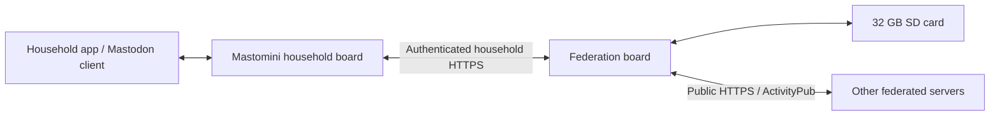

# Federation roadmap: a second board with SD storage

Status: exploratory proposal, not implemented or a measured capacity claim.
Written October 5, 2026, from the two-board federation discussion.

## Objective and current boundary

Add optional Mastodon federation through a separate federation board (FB),
while preserving the availability and bounded resource use of the household
Mastomini board. The proposed FB has public inbound/outbound HTTPS connectivity
and a 32 GB SD card.

Current Mastomini is deliberately non-federating: no ActivityPub, remote
accounts or remote WebFinger discovery. Its accounts, status authors and
relationships assume a small local household. Accounts occupy 16 slots, and
several relationships use local slot-based structures. Federation therefore
requires new software and a remote account/object model; exposing the existing
Mastodon REST API publicly does not provide federation.

This document proposes an optional extension to the existing
[architecture](01-overview.md) and [limits](03-limits.md), rather than changing
the current implementation's guarantees.

## Two-board architecture



Mastomini owns household accounts, login, local posts and household permissions.
FB owns public actor identities, federation signing keys, remote account
discovery, remote posts, delivery state and network retries.

FB presents identities such as `@alice@social.example.com`. A stable public
domain, publicly usable HTTPS certificate and reachable public endpoints are
needed for the proposed deployment. A household `.local` address and household
CA alone do not supply that public reachability or trust. Inbound connectivity
could use a routable connection, reverse proxy or tunnel; the deployment choice
is still open.

Public actor, object and activity URLs remain stable across reboots and retries.
The domain and signing keys are identity-bearing state, not disposable caches.

The SD card provides room for remote profiles, text, queues, deduplication
records and indexes. It does not increase CPU speed, RAM, TLS concurrency or
network capacity. Capacity must be measured on the chosen hardware.

## Private API: Mastomini to FB

Proposed routes use a versioned JSON API on the household interface. These names
are not existing endpoints. Pair the boards with a device credential over
household HTTPS; mutual TLS is a possible implementation. Pairing and policy
changes require household administrator authorization.

Mastomini authorizes each household action. FB restricts the paired device to
its registered actors. Public callers cannot reach the bridge API merely by
knowing a URL. Bridge credentials and federation private keys are never
returned in health, progress or event responses.

| Endpoint | Purpose |
|---|---|
| `PUT /bridge/v1/actors/{local_account_id}` | Register/update a public identity; return permanent actor URL and public address |
| `POST /bridge/v1/commands` | Durably queue publish, edit, delete, follow, unfollow, like, boost or follow-request decisions |
| `GET /bridge/v1/commands/{id}` | Report queued, applied, delivering, completed or failed state, including partial delivery |
| `GET /bridge/v1/events?after={cursor}&limit=32` | Return bounded pages of mentions, replies, follow requests, relationship changes and delivery failures |
| `POST /bridge/v1/events/ack` | Acknowledge that Mastomini durably processed events through a cursor |
| `GET /bridge/v1/actors/{id}/home?before={cursor}` | Read a bounded page of a household member's remote feed |
| `GET /bridge/v1/objects/{id}` | Retrieve an authorized cached remote object or conversation item |
| `PUT /bridge/v1/policy` | Configure allowed/blocked domains, quotas and retention |
| `GET /bridge/v1/health` | Queue depth, oldest pending delivery, SD health/free space and recent failures |

### Publish command

```http
POST /bridge/v1/commands
Idempotency-Key: mm-post-123-revision-1
Content-Type: application/json
```

```json
{
  "type": "publish",
  "actor": "household-account-7",
  "local_post_id": "123",
  "revision": 1,
  "text": "The NanaCoin daily report!",
  "visibility": "public",
  "reply_to": null
}
```

FB returns `202 Accepted` only after committing the command to durable storage.
The response includes a command ID, assigned public object URL and queued state.
It means accepted for processing, not delivered to every remote server.

Repeated submissions with the same idempotency key and payload return the same
command/result. Reusing a key with a different payload is an error. Commands
need explicit ordering/version rules so a delayed edit cannot resurrect a
deleted post. Idempotency record retention must cover the agreed retry window.

### Follow command

```json
{
  "type": "follow",
  "actor": "household-account-7",
  "target": "alice@example.org"
}
```

FB performs WebFinger discovery, resolves the actor, sends a signed `Follow`,
and handles `Accept` or `Reject`. It then emits a relationship event for
Mastomini. A submitted follow remains pending until accepted.

Other commands use the same envelope and stable references to remote actors,
objects or activities. Mastomini does not need to construct ActivityPub JSON.

### FB to Mastomini: polling and feeds

Prefer polling the events endpoint over callbacks into the household board.
An event carries a cursor, event type, affected household account and object
reference. Example types include `follow.accepted`, `follow.rejected`,
`follow.requested`, `post.mentioned`, `post.replied` and `delivery.failed`.

Mastomini acknowledges only after saving the relevant local state. Unacknowledged
events can be replayed and consumers must deduplicate them. Event retention is
bounded: an expired cursor returns an explicit gap requiring resynchronization,
rather than silently skipping events.

The full remote feed remains on FB. Mastomini or its app requests small pages
when needed; remote actors never consume household member slots. Feed and
object reads must enforce the requesting member's authorization.

An initial separate remote-feed view in the household app is simpler than
integrating federation into every existing client endpoint. Supporting remote
accounts seamlessly in unmodified Mastodon clients is an additional project:
lookup/search, account entities, follows, replies, notifications, timeline
merging, ID mapping and pagination all need consistent behavior.

## Public API: outside world to FB

Assume the public domain is `social.example.com`. The route spellings below are
our choices; WebFinger and actor documents advertise the actual URLs.

| Endpoint | Purpose |
|---|---|
| `GET /.well-known/webfinger?resource=acct:alice@social.example.com` | Discover the actor URL for an address |
| `GET /users/{name}` | Actor document: profile, public key and endpoint URLs |
| `POST /users/{name}/inbox` | Receive activities addressed to one actor |
| `POST /inbox` | Shared inbox for eligible deliveries involving local actors |
| `GET /users/{name}/outbox` | Paginated published activities with visibility enforced |
| `GET /users/{name}/followers` | Follower collection under the selected disclosure policy |
| `GET /users/{name}/following` | Following collection under the selected disclosure policy |
| `GET /objects/{id}` | Published post, or deletion tombstone, with authorization enforced |
| `GET /activities/{id}` | Activity representation when its visibility permits |

WebFinger returns its discovery representation; actor, object and activity
responses use the appropriate ActivityStreams content type. Human-readable
profile/post pages can be added separately or through content negotiation.

Incoming activities include `Follow`, `Accept`, `Reject`, `Create`, `Update`,
`Delete`, `Like`, `Announce` and `Undo`. FB verifies signatures and authority:
possession of a valid signing key alone does not authorize changing another
actor's objects. Activities are deduplicated by stable IDs.

References: [WebFinger](https://docs.joinmastodon.org/spec/webfinger/),
[Mastodon ActivityPub behavior](https://docs.joinmastodon.org/spec/activitypub/)
and [ActivityPub](https://www.w3.org/TR/activitypub/).

## Outbound API: FB to other servers

| Request | Purpose |
|---|---|
| WebFinger lookup | Resolve a remote address to an actor URL |
| Fetch actor document | Obtain inbox/shared inbox URLs and verification keys |
| Fetch referenced objects | Resolve permitted replies, mentions and other references |
| Signed `POST` to the advertised inbox/shared inbox | Deliver posts, follows, replies and other activities |

FB signs outgoing requests and verifies incoming ones. Some remote servers also
require signed fetches. Follow acceptance and recipient addressing determine
delivery; posting does not broadcast to every server in the fediverse.

Ordinary public follower deliveries can be grouped by shared inbox, reducing
many followers on one server to one delivery. Addressing/privacy constraints
and servers without usable shared inboxes can require individual delivery.
References: [request signing](https://docs.joinmastodon.org/spec/security/) and
[shared inbox delivery](https://www.w3.org/TR/activitypub/#shared-inbox-delivery).

## Availability, privacy and storage rules

- Local posting and household reads never wait for remote delivery. Network
  work runs outside the household API lock, with bounded background workers.
- Save a local post and its federation export intent together. A background
  worker submits that intent and retries it until FB durably acknowledges it.
  A crash between posting and submission must not lose the export.
- Make federation opt-in per account/action. Local visibility settings alone
  are not permission to export existing household content. Start with public
  text; followers-only and direct/private delivery require a separate policy
  and authorization milestone.
- Store one outgoing payload plus small per-destination delivery records,
  rather than duplicating the payload for every server.
- Bound inbox bodies, parsing depth, queues, caches, feed pages, concurrent
  TLS connections and disk use. Cache discovery/keys with bounded refresh rules.
- Schedule retries per destination with backoff and fairness. An unavailable
  server cannot monopolize workers or hold up healthy destinations.
- Use a recoverable durable queue/journal with checkpoints on SD. Test power
  cuts, partial writes, card removal, disk-full errors and corrupted records.
  A 32 GB capacity claim is not a durability guarantee.
- When FB or SD fails, pause federation and expose its health; local Mastomini
  continues operating within its own limits. When an export queue fills,
  report the federation failure or limit explicitly rather than silently
  claiming successful remote publication.
- Reject or return retryable errors when incoming work cannot be durably
  accepted. Do not acknowledge delivery and then silently discard it.
- Apply domain policy, remote URL/redirect validation, protection against
  fetching private network addresses, HTML sanitization and spam/rate limits.
  Discovery and signature validation cannot become an unrestricted URL-fetch
  service.
- Keep remote-feed retention independent of the local post ring. Preserve
  public object availability and deletion information under a defined policy.
- Back up public identity mappings and signing keys securely. Restrict physical
  access to SD contents; decide encryption and key placement before deployment.

## Worked traffic model

User scenario:

- Five household users.
- Each follows ten remote accounts: 50 follow relationships, at most 50 unique
  followed accounts.
- Each has 500 remote followers: 2,500 follower relationships; the same person
  may follow multiple household accounts.
- Followers are distributed across 75 federated servers.

Followers do not cause their timelines to arrive at FB. Timeline traffic comes
from accounts the household follows. Followers add traffic through follows,
unfollows, mentions, replies, likes, boosts and discovery/fetch requests.

### Outbound fan-out

For ordinary public posts with shared inbox delivery:

`daily deliveries = sum(local user's daily posts × that user's destination inbox count)`

If **each** household user's followers span all 75 servers, each post produces
about 75 delivery jobs. If 75 is only the union across all five users, the count
per user may be smaller. For example, five disjoint sets of 15 servers would
produce 750 deliveries/day at ten posts per user, rather than 3,750.

| Posts per household user/day | Total local posts/day | Deliveries/day if every user's audience spans 75 shared inboxes |
|---|---:|---:|
| 2 | 10 | 750 |
| 10 | 50 | 3,750 |
| 50 | 250 | 18,750 |

Without shared inbox consolidation, a post to 500 followers could require up
to 500 individual inbox deliveries. Additional addressed recipients can also
increase the destination count.

### Example day: ten local posts and twenty remote posts per account

Assume all 50 followed accounts are distinct and each produces twenty eligible
posts/day. Assume each household user publishes ten public posts/day, reaching
75 shared inboxes.

| Traffic | Calculation | Requests/day |
|---|---|---:|
| Outbound post deliveries | 5 × 10 × 75 | 3,750 |
| Incoming followed-account posts | 50 × 20 | Approximately 1,000 |
| Baseline | Before interactions, fetches and retries | Approximately 4,750 |

Following overlap and shared inbox delivery can reduce incoming requests; the
same remote activity should be stored once and routed to all authorized local
recipients. Remote boosts, edits, deletions and other eligible activities add
to a model that counts only new posts.

Using an **illustrative 5 KB JSON activity**, the baseline payload volume is
approximately 18.75 MB outbound and 5 MB inbound per day. Decimal KB/MB are used.
These are assumed sizes, not captured Mastodon traffic. HTTP headers, TLS,
responses, discovery, interactions, retries and media are additional.

The 1,000 incoming activities would add about 5 MB/day or 1.8 GB/year before
indexes, profiles and other records. A 32 GB card has ample capacity for this
bounded text workload, subject to retention and free-space reserves. Automatic
image/video downloads could dominate both storage and bandwidth and are
excluded from the first milestones.

### Bursts and worker occupancy

The baseline averages about one request every eighteen seconds across a day,
but requests do not arrive evenly. One local post immediately creates roughly
75 jobs; five simultaneous posts create roughly 375.

The following assumes **two seconds of occupied worker time per outbound
delivery**. It is arithmetic to illustrate queue behavior, not an ESP32
benchmark or a prediction of remote server latency.

| Work | Delivery jobs | Single-worker occupancy |
|---|---:|---:|
| One local post | 75 | 150 seconds: 2½ minutes |
| Five simultaneous local posts | 375 | 750 seconds: 12½ minutes |
| Example day's outbound posts | 3,750 | 7,500 seconds: about 2 hours 5 minutes |

More workers may reduce completion time, at the cost of RAM and competing CPU,
socket and SD work. TLS setup, request signing, incoming verification and
uncached profile/key fetches must be measured. Connection reuse helps but does
not justify keeping 75 simultaneous TLS connections open.

Retries add attempts: if there are an extra 10% delivery attempts, the 3,750
base deliveries become 4,125 attempts. Persistent failures and slow timeouts
can cost much more than their request count suggests.

### Initial relationship setup

Establishing 2,500 follower relationships can involve roughly 2,500 incoming
follow requests and 2,500 outgoing accept/reject responses, plus discovery and
key/profile fetches. The 50 outgoing follows add follow and response traffic.
These are setup/churn events, not daily traffic simply because the relationship
exists. Process large setup waves gradually and retain progress durably.

## Staged implementation roadmap

### 0. Hardware and protocol feasibility

- Choose the board, SD interface, public connectivity and stable domain.
- Build a desktop FB prototype before porting its bounded core to ESP-IDF.
- Measure TLS connections/handshakes, signing, verification, parsing, SD commits
  and RAM/stack use, including inbound traffic during an outbound burst.
- Exercise SD power-loss recovery and identity backup/restore.

Exit: measured resource budgets and a recoverable queue. Decide whether an
ESP32 is suitable or the same API should run on a more capable board.

### 1. One public account and outbound text

- Pair Mastomini and FB; register one opt-in public bot identity.
- Serve WebFinger, actor/key documents, objects and required collections.
- Receive follows and send acceptance; publish signed text activities to
  followers with shared inbox grouping, idempotency and retries.
- Support edits/deletes for exported posts and show delivery health.

Exit: a real remote Mastodon account can discover/follow the bot and receive
posts and lifecycle changes. Reboots and ambiguous responses do not duplicate
publication or lose accepted commands; local service remains responsive.

### 2. Incoming replies, mentions and interactions

- Validate inbound signatures/authority, deduplicate activities and enforce
  domain policy and limits.
- Expose bounded events to the household app and allow public replies.
- Add follow approval, unfollow/undo and basic blocking behavior.

Exit: two-way public conversations work, including replay, deletion, malformed
payloads and destination failure tests.

### 3. Remote follows and separate remote feed

- Resolve remote accounts, track pending/accepted follows and handle unfollows.
- Store received posts on SD and expose authorized paginated feeds.
- Keep remote IDs and relationships separate from household slots.
- Add the household app's remote-feed view and retention/resync behavior.

Exit: five household users can independently follow remote accounts without
remote traffic exhausting local account or post capacity.

### 4. Load validation and broader client integration

- Test the worked 5-user/50-follow/2,500-follower/75-server scenario with a
  configurable load generator and selected real-server interoperability tests.
- Include bursts, duplicate deliveries, offline destinations, incoming spam,
  saturated queues, SD faults and household/FB restarts.
- Record median/tail delivery latency, queue age/drain rate, retry cost,
  household API latency, heap/PSRAM low-water marks and SD write volume.
- Choose acceptable delivery delays and enforce measured workload limits.
- Then decide whether to merge remote data into the standard Mastodon client
  API and whether to support media or restricted-visibility federation.

Exit: documented tested limits and failure behavior. This proposal is a
credible prototype workload, not a guarantee of instantaneous delivery or
unlimited federation on an ESP32.

## Decisions still needed

1. Exact FB hardware, SD interface, public ingress and certificate management.
2. Public identity domain, enrollment, signing-key protection and recovery.
3. Initial server allowlist versus open federation, and moderation ownership.
4. Command ordering, retry windows, event retention and cursor-gap recovery.
5. Text-only content limits, long remote posts, media links and later attachments.
6. Separate household-app feed versus transparent ordinary-client integration.
7. Delivery-latency targets, queue/storage quotas and the hardware upgrade threshold.

## Protocol references

- [W3C ActivityPub](https://www.w3.org/TR/activitypub/): actors, collections,
  follow acceptance, delivery and shared inbox semantics.
- [Mastodon ActivityPub](https://docs.joinmastodon.org/spec/activitypub/):
  supported activities, content handling and interoperability extensions.
- [Mastodon WebFinger](https://docs.joinmastodon.org/spec/webfinger/): address
  discovery and actor links.
- [Mastodon federation security](https://docs.joinmastodon.org/spec/security/):
  HTTP request signatures and authentication behavior.
