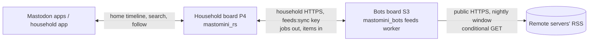

# Following accounts off the board, by RSS

Status: implemented 2026-10-22 (see "As built" below), not yet on the
boards. Written 2026-10-22. It replaces the browser-side "Remote accounts"
reader added (uncommitted) before this review.

## As built

Decisions taken after the design below, by the household admin:

- **Search runs on the household board.** A member's search is one hop,
  member → household board → other server; the bots board is never in the
  middle of a member's action. `@name@server` asks that server's
  `/api/v1/accounts/lookup`; a name (with `resolve=true`) asks the search
  server, `mastodon.nu` by default, admin-set, blank to turn name searches
  off. The adapter (`server.rs` `remote_lookup`) fetches before taking the
  service lock, with a 4 s timeout and a 64 KiB answer limit. Answers are
  cached 10 minutes, and each member gets 30 searches an hour. The
  connection loop still waits for the fetch (handlers cannot answer later),
  so a search briefly pauses the board for everyone: about 0.3–0.9 s on the
  desktop, more on the P4 for its first TLS handshake. Unmeasured on the board.
- **Following is RSS, fetched off the board.** The fetcher is a bot on the
  bots board, `feeds` (`mastomini_bots/src/bots/feeds.rs`). Its "server" is
  the household board and its "API key" a device key. It gets the schedule
  (daily 03:00 by default), settings form, Run now, Check and run history from
  the bot framework. One run fetches every feed in turn, with a time budget
  (30 min). Feeds it does not reach go first next night.
- **Signing in to the search server (2026-10-23).** Anonymous searches only
  find account names (servers want an account for post search, and some
  for hashtag timelines). An admin picks the search server on the admin
  page and signs in there: the board registers itself as an app
  (`read:search read:statuses read:accounts`), the admin's browser logs in
  on the server's own page (OAuth with PKCE), and the server sends it back
  to `/api/mastomini/v1/remote/oauth/callback`. The board exchanges the code,
  asks who signed in, and stores the token (`mm_remote`, never shown). Every
  member's searches then use it: one signed-in `v2/search` (accounts and
  posts, resolved) and `#tag` timelines. Found posts live in RAM (80), open
  in any app, link to their pictures instead of fetching them, and their
  authors can be followed by RSS. The household searches as that one
  account; an API key could replace the sign-in later.
  Code: `mastomini_rs/src/api/remote_search.rs`.
- **No allowlist or approval yet.** Any member can follow within the limits.
  The policy section below is future work.
- **Limits** default to 30 for the household and 10 per person, admin-set
  (household app: Accounts elsewhere, admin page).
- **Posts stay in NVS** (`mm_remote`, at most 1,280); **pictures only on the
  SD card**. No card means no pictures. The P4 mounts its TF card at boot
  (`components/p4-network/sd_card.c`, slot 0, LDO channel 4); a failed mount
  means no pictures.

Differences from the design:

- The bots board's HTTP client exposes no response headers, so "conditional
  GET" is a hash of the feed body: an unchanged feed is reported
  `not_modified` and nothing is parsed or pushed. Bandwidth is not saved.
- Pictures: JPEG and PNG become JPEG previews (PNG read row by row);
  Mastodon's `/small/` copy is tried before the original. WebP, GIF and
  video stay links. Posts rated adult get no pictures.
- `jobs` also reports each feed's newest stored post (`newest_ms`), so
  pictures are fetched only for new posts.
- Device keys skip the bots board's profile publication (they are not
  accounts).

Verified: household API tests (search, follow, weaving and paging, read-only
posts, limits, device keys, images, reboot), bots unit tests (RSS and Atom,
previews, URL checks), an in-process test of a whole night from the bots
board to the household board, and a desktop run against live servers:
mastodon.social's real feed gave 20 posts and 3 pictures, served from the
media directory. Not verified on hardware: the TF card mount, the P4's
public search client, the household board's latency with a full cache, and
the bots firmware (its firmware build is blocked by an unrelated, pre-existing
esp-idf-sys duplicate-component error from its dev-dependencies).

## What the household asked for

1. Find accounts that live elsewhere (Mastodon and similar) and follow them.
2. No federation: no ActivityPub, no public domain, no signing keys, no
   inbound queues. Read public posts over RSS instead.
3. Followed accounts' posts appear **in the home timeline**, woven between
   household posts, in every Mastodon app, not on a separate page.
4. Feeds are fetched **in the middle of the night**, not while people use the
   board. The board is slow to open connections; 10–50 feed fetches during the
   day would be felt by everyone.
5. Limits an admin can set: about **30 feeds for the board, 10 per account**.
6. Children are members. An admin can require that only approved accounts be
   followed, or can switch that off.

## Review of the current uncommitted work

Files: `mastomini_rs/src/domain/remote.rs`, the `me/remote` routes in
`mastomini_rs/src/api/household.rs`, `Kind::RemoteSubscriptions` in
`codec.rs`, `mastomini_ui/src/app/remote.ts`, `pages/remote.ts`, the nav entry
in `app.ts`/`app.routes.ts`, and the "Reading public accounts elsewhere"
section of `docs/usage/connecting-apps.md`.

It is a different feature from the one asked for. Do not ship it as is.

| # | Finding | Requirement |
|---|---|---|
| 1 | Posts never enter the home timeline. They show only on `/app/#/remote`, so Ivory, Tusky, Elk and the web client never see them. The doc admits this. | 3 |
| 2 | The **browser** fetches live, on every page open: two requests per followed account (`accounts/lookup`, then `statuses`), up to 32 accounts, 4 at a time. Nothing happens at night, and nothing is cached. | 4 |
| 3 | It is not RSS. It uses the remote server's REST API without authentication, which fails on servers that turn off unauthenticated API access, and on non-Mastodon software. | 2 |
| 4 | Free-text search sends every query to **mastodon.nu**, a third party, from the child's device and IP address. The results are whatever that server has indexed, adult accounts included. | 6 |
| 5 | No policy: any member can follow any handle. No allowlist, no approval queue, and an admin cannot see what members follow. | 6 |
| 6 | Limits are hard-coded at 32 per account. There is no board total and no admin setting. | 5 |
| 7 | Each household device connects directly to arbitrary remote servers, which shows them the household's IP address and when someone is reading. `credentials: 'omit'` and `no-referrer` are good but do not stop that. | privacy |
| 8 | Only `spoiler_text` is honoured. The `sensitive` flag is ignored. | 6 |
| 9 | The `POST`/`DELETE me/remote` routes accept any token with `write`, so a third-party Mastodon app can change the household's remote subscriptions. | minor |
| 10 | Tests: one domain test, plus UI tests with a mocked `fetch`. There is no API route test, and nothing touches the timeline (because nothing is in it). | — |

Worth keeping: the handle validator `normalized()` (lowercase, no `.local`, no
IP literals, label rules), the slot-reuse guard (`account_id` stored with the
handles), and erasing the record when an account is deleted. The store has
only test data, so `Kind::RemoteSubscriptions` can be replaced without a
migration (wipe needed).

Recommendation: remove the `/remote` page, its nav entry and the docs section.
Keep `normalized()` and move it into the new module.

## Architecture

**The household board never talks to the internet.** It owns the policy,
subscriptions, the directory of remote accounts, the cached items and the
timeline weaving. It answers every request from local state, so a slow or
missing remote server can never slow down a home timeline.

**The bots board fetches.** A new `feeds` worker in `mastomini_bots` runs in a
nightly window. It asks the household board which feeds are wanted, fetches
each one with a conditional GET, parses and sanitizes the XML, and pushes plain
items back to the household board.

### Why the bots board fetches (decision 1)

| | Bots board fetches (recommended) | Household board fetches |
|---|---|---|
| Public HTTPS client | Already exists: `EspClient` with the public CA bundle, `send_bounded`, reconnects | New: the P4 has only the household-CA handoff client (`scheduler_client.rs`) |
| Scheduling, quiet hours, time zone | Already exists (scheduler, `Schedule`, `tz`) | New |
| Parsing untrusted internet XML | On the board that holds no household data | On the board with every member's posts and DMs |
| TLS session budget during the day | Untouched | Untouched only if the window is respected |
| Moving parts | Two boards and one bridge API | One board |
| When the bots board is down | No new items; everything else works | n/a |

Both work. The bots board is less new code and keeps the household board's
promise of "no third-party anything" (`spec/01-overview.md`). The bridge
follows the pattern of the existing scheduler handoff, in the opposite
direction.

## Data model (household board)

New namespace `Ns::Remote`, so remote items never compete with household
posts for the 4,096-status ring.

**RemoteAccount** (one per feed, at most `feeds_max_board`)
- `id`: a snowflake from the shared `IdGen`, used as the Mastodon account id
- `acct`: `user@host` (lowercase, validated by `normalized()`), or `None` for
  a plain feed
- `feed_url`: `https://host/@user.rss` for Mastodon. For other feeds, an
  admin-entered https URL (decision 4)
- `display_name`, `profile_url` (from the feed's `<channel>`, sanitized)
- `state`: `pending` (not fetched yet) · `ok` · `failing{n}` · `gone` ·
  `blocked`
- `approved`: bool. The allowlist is the set of approved accounts
- `followers`: `AccountMask` of household slots (see "How remote accounts
  appear" for slot reuse)
- `etag`, `last_modified`, `last_ok_ms`, `last_error` (short, fixed text)

**RemoteItem** (at most `items_per_feed` per feed, default 20; ring per feed)
- `id`: a snowflake from **ingest time** (see Timeline)
- `feed`: RemoteAccount id
- `guid_hash`: u64, for idempotent re-pushes
- `published_ms`, `url` (https, original post)
- `text`: plain text, at most 500 characters, links kept as URLs
- `cw`: optional, at most 120 B · `sensitive`: bool · `media`: count only

Worst-case size: 30 feeds × 20 items × about 800 B ≈ 480 KiB of NVS. Add a row
for it in `spec/03-limits.md` and the `store` budget. The index lives in
PSRAM.

**Settings** (admin, board-wide)
- `remote.enabled` (default off)
- `remote.member_policy`: `allowlist` · `approval` · `open` (decision 2)
- `remote.feeds_max_board`: default 30, admin-settable from 0 to 64
- `remote.feeds_max_account`: default 10, admin-settable from 0 to 32

Lowering a limit below current use never unfollows anything. It blocks new
follows until use is under the limit, and the admin page shows "34 of 30"
in red.
- `remote.blocked_hosts`: a denylist, always applied, admins included

One feed followed by three people counts once toward the board total and once
toward each person's limit.

## Policy and children

- **Admins and owners** can always follow any valid handle within the limits.
  Their follows are approved automatically.
- **Members**, depending on `member_policy`:
  - `allowlist`: may follow only approved accounts. Search shows only
    approved accounts.
  - `approval` (recommended default): may request any valid handle. The
    request shows on the admin moderation page ("Ana wants to follow
    @x@y") with one-tap approve or deny. Once approved, an account is on the
    allowlist for everyone. No fetch happens until it is approved.
  - `open`: may follow any valid handle, as admins can.
- Blocking a host or an account removes it for everyone at once and drops its
  items.
- Items flagged sensitive or adult (an RSS `media:rating` of `adult`, or a CW)
  are always hidden behind a CW, and are **dropped for members** unless the
  policy is `open`. Check against real feeds which flags Mastodon's RSS
  carries (open question 1).
- Images: none until the media epic (32 GB SD card) provides storage and
  `media_attachments`. Until then, items say "1 image — open the original".
  Linking images directly would leak household IP addresses and break the
  "fetch at night" rule. See "Images, with the media epic" below.
- An admin can see every remote follow (account, followers, state) on one
  page.

## Search and follow

No live internet search. Searching the whole fediverse by name needs an index
the board does not have. Borrowing a public server's index sends the
household's queries to a third party and returns unfiltered results (review
finding 4).

What search does:

1. **The directory**: name or handle search over the RemoteAccount table, all
   local. For members under `allowlist`, only approved accounts.
2. **An exact handle** (`@user@host`, or a profile URL
   `https://host/@user`): validated locally, with no network call. If the
   policy allows, `GET /api/v2/search?resolve=true` returns a **synthetic
   Account** for it, with state `pending`. Following it creates the
   RemoteAccount, which the next nightly run verifies (`404` → `gone`, and
   the follower is told in the household app).

This works from phone apps: search `@user@host`, open the result, tap Follow.
`POST /api/v1/accounts/:id/follow` on a remote id becomes a subscription.
Limit or policy failures return `422` with a readable message. Unfollow,
`relationships` and `following` work the same way.

The household app gets a "Following elsewhere" page (directory, paste a
handle, my follows and their state, "posts appear after tonight's update at
02:00"). Admins get the policy, limits, approvals and blocked hosts.

## Timeline weaving

- `Entry::Remote(id)` joins `Entry::Status` and `Entry::Boost`. `home()` merges
  the local entries iterator with the remote items of feeds the viewer
  follows, by id, inside the existing `paginate`. Remote items never appear in
  the public, local or tag timelines, lists, notifications, or search.
- **Ids come from ingest time, not publish time.** Clients page with
  `since_id`/`min_id`. An item from yesterday afternoon that gets an id from
  yesterday afternoon at 03:00 sorts below the client's last-seen id and is
  never shown. With ingest-time ids, the night's batch arrives as new posts at
  the top in the morning, ordered by publish time within the batch.
  `created_at` shows the real publish time.
- Status JSON: `account` is the synthetic remote Account (`acct: user@host`,
  `url`: the profile, the board's default avatar, note "Read by RSS through
  mastomini"). `uri`/`url` is the original post. `content` is `
` + escaped
  text with linkified URLs. `visibility: public`, all counters 0.
- Read-only. Favourite, boost and reply return `422` "Posts from other servers
  are read-only here". Bookmarking could come later. `context` is empty.
- v2 filters (keywords) apply to remote text. Muting a remote account equals
  unfollowing it for that member.
- Cost: the merge is O(page) over two sorted sources. Measure it on the P4 at
  600 items (`spec/08-performance.md`) before calling it done.

## Machine-to-machine authentication

### What exists today, and why it does not fit

The only link between the boards is the scheduled-posts bridge
(`domain/scheduled.rs` `Bridge`, `mastomini_bots/src/scheduler.rs`). It
reuses **a bot member's Mastodon API key**:

- The household board sends handoffs to the bots board with that key as the
  bearer. The bots board accepts the handoff if the bearer equals a token
  configured on one of its bots.
- That key belongs to an account. It uses one of the 32 account slots, has
  `read write` scopes, and anyone who holds it can post as that bot.

Every credential the household board accepts is tied to a slot
(`Principal.slot`). The only exception is the `client_credentials` app
token, which lives in RAM and can be obtained by any registered app. So
**there is no suitable machine credential today**, and the feeds bridge
should not borrow a bot's key: "fetch feeds" would then also be "post as
Nana News".

### Proposal: device credentials

A small, separate table of machine credentials. They use no account slot and
cannot sign in.

- **Record** (`Ns::Cfg`, at most 4): `id`, `name` ("Bots board"),
  `secret_hash` (SHA-256 of a 32-byte random secret), `scopes` (only
  `feeds:sync` for now), `created_ms`, `last_used_ms`, `revoked`.
- **Issuing:** an admin creates it on the household admin page. The secret
  is shown once, prefixed `mmdev_` so it is easy to recognise in logs and
  secret scanners. The admin pastes it into the bots board's admin page, as
  is done today for the scheduler key.
- **On a request:** `Authorization: Bearer mmdev_…` resolves to
  `Principal { slot: None, device: Some(id), scopes }`. Every member route
  already needs a slot, so it answers `401`/`403`. Feed routes need
  `device.is_some()` and the scope. `feeds:sync` is **not** in
  `KNOWN_SCOPES`, so no OAuth app can request it.
- **Transport:** the bots board connects to the household board and checks
  its certificate against the household CA, which it already does for
  `.local` names. The secret only travels to a board that proves it is the
  household board. Mutual TLS is not needed on a home LAN and can come
  later.
- **Revoking:** one click on the admin page. Feed jobs stop at once, and the
  fetcher's next run reports `401` in its status, which the SRE digest picks
  up.
- **Rate:** device calls go through the existing governor, with their own
  bucket: at most 30 job reads and 64 result pushes a night.

Later, the scheduled-posts bridge could move to a device credential too, which
would free its bot from double duty. That is not part of this work.

## How remote accounts appear

Remote accounts are **data, not accounts**. They have no slot, no password, no
tokens, and no bit in any `AccountMask` of their own. Mastodon apps still see
ordinary-looking accounts, because the API builds an Account object from the
RemoteAccount record.

- **Ids:** taken from the shared `IdGen`, the same snowflake space as local
  account and status ids, so they never collide. One lookup,
  `resolve(id) -> Local(slot) | Remote(id)`, replaces the direct
  `slot_of`/`account_by_id` calls in the routes that must understand both
  kinds. About 30 call sites today; most stay local-only and simply answer
  `404` for a remote id.
- **Account JSON:** `acct: "user@host"`, `username: "user"`, `url`: the
  profile, `display_name` and `note` from the feed's channel, `avatar`: the
  board default until the media epic lands (below), `bot: false`,
  `locked: false`, `followers_count`: household followers only,
  `following_count: 0`, `statuses_count`: cached items, `fields: []`.
- **Supported for remote ids:** `GET /accounts/:id`, `/:id/statuses`
  (cached items), `follow`, `unfollow`, `relationships`, `lookup?acct=u@h`,
  search. A member's `/:id/following` lists their remote follows too, so
  unfollowing works from apps.
- **Answering `422` or `404`:** mention, DM, reply, boost, favourite, block
  (use unfollow, or ask an admin to block it), report, add to list, note,
  endorse. Remote accounts never get notifications.
- **Followers:** each RemoteAccount stores an `AccountMask` (u32, one bit per
  household slot) of who follows it. Deleting a household account clears its
  bit in the existing erasure sweep, so a reused slot never inherits follows.
  This replaces the stored `account_id` guard in the current code.
- **Lifecycle:** a RemoteAccount with no followers keeps its directory entry
  (and its approval) but drops its items and is not fetched. An admin can
  delete it.

## Bridge API (household board ↔ bots board)

Authentication: a device credential with `feeds:sync` (above). These routes
accept nothing else, and device credentials reach no other route.

- `GET /api/mastomini/v1/feeds/jobs` →
  `[{feed, url, etag, last_modified}]` for every approved feed with at least
  one follower, not `blocked`.
- `POST /api/mastomini/v1/feeds/{feed}/result` with
  `{outcome: ok|not_modified|gone|failed, etag, last_modified, title, items: [...]}`,
  at most 20 items and 16 KiB. Add it to the `http::body_limit` table.
  Pushes are idempotent by `guid_hash`, so retries are safe.
- `POST /api/mastomini/v1/feeds/{feed}/result` for a feed that was unfollowed
  in the meantime returns `410`, and the worker drops it.

## The fetcher (bots board)

- A `feeds` worker on the existing timer worker thread, using the same
  `EspClient::scheduler` client, not a bot with a Mastodon account.
- Window: default 02:00–05:00 household time, set in the bots admin. It
  starts at a random minute in the window. Feeds are fetched **one at a time**,
  15 s timeout, `send_bounded` 256 KiB, conditional GET (`If-None-Match`,
  `If-Modified-Since`). Each feed is fetched at most once a night. A `429`
  or `Retry-After` means skip until tomorrow.
- Expected cost: 30 feeds × about 2–3 s ≈ 1–2 minutes a night.
- "Fetch new follows now": optional, admin-enabled. It fetches only feeds in
  the `pending` state, at most N a day, so a new follow can show posts before
  the night. It is still the bots board doing it, and the household board
  receives one small POST.
- Parser: a pull parser (`quick-xml`) with no DTDs or entities, at most 20
  items, HTML descriptions reduced to text by an allowlist, every field
  truncated. RSS 2.0 and Atom.
- URL safety: https only. The feed host must not be a household host
  (`household_trust::household_host`) and must not resolve to a private or
  loopback address. Check the resolved address, not just the name. No
  redirects to another host.
- Status: the SRE bot's health reads gain a `feeds.last_run` check
  (last run, ok/failed counts), so a silent fetcher shows up in the morning
  digest.

## Images, with the media epic

Once the SD card media store exists, remote images use the same path as text:

- The fetcher downloads, at night only, the avatar and at most 4 images per
  item. It never downloads images for items dropped by policy.
- **Previews only.** The bots board turns each image into a preview (at most
  640 px on the long side, about 64 KiB) before pushing it. The household
  board never decodes or resizes a remote image. The original stays on its
  server, linked as "open the original" (`remote_url`).
- **Checks before decoding,** applied in order:
  1. The `Content-Type` must be JPEG or PNG, and the `Content-Length` must
     be at most 1 MiB. Anything larger is never downloaded. The item keeps
     only the link.
  2. Dimensions come from the first few KB (JPEG SOF, PNG IHDR). An image over
     16 megapixels is skipped, which also refuses decompression bombs.
  3. WebP, GIF, HEIC and anything else are link-only for now. Decoding them
     is too heavy for the S3.
- **Resizing on the S3:** a JPEG is decoded at a scale of 1/2, 1/4 or 1/8
  (`esp_jpeg`/TJpgDec), choosing the largest scale whose output is at least
  the preview size. The decoder works one band of rows at a time, so memory
  stays at a few KB whatever the source size. The preview is re-encoded as
  JPEG. A PNG is decoded row by row and box-averaged while it is read. Each
  image gets a time limit of 5 s; one that runs over is link-only.
- **Privacy:** re-encoding drops all metadata (EXIF, GPS, ICC, comments).
  The rotation from the EXIF Orientation tag is applied to the pixels first.
- The fetcher pushes previews to the household board as media uploads under
  the device credential, and the item references the media ids. Uploads are
  small and arrive at night over the LAN, so the blocking streamed-body path
  (below) is acceptable here.
- The household board checks every push again: JPEG only, at most 640 px and
  128 KiB, read from the header. Anything else gets `422`, so a faulty or
  compromised fetcher cannot store large files.
- Apps load images from the household board, never from the remote server.
- Sensitive images are always `sensitive: true` (blurred). For members they
  are dropped, as the item is.
- Retention follows the items: when an item leaves its feed's ring, its media
  is deleted. Worst case: 30 feeds × 20 items × 4 × 128 KiB ≈ 300 MiB, plus
  30 avatars. Set a separate admin quota (default 256 MiB) and evict the
  oldest first.
- Measure on the S3 before fixing the limits: a 4000×3000 JPEG at 1/8, and a
  2048×2048 PNG (time and peak heap). Record the results in
  `spec/08-performance.md`.

This depends on the media epic's storage API. Bring it in as phase 8, after the
media epic ships.

### Image traffic and the serving loop (applies to the whole media epic)

miniframework's `mux` serves every connection from one task, one bounded
read and one bounded write per client per turn.

- **Sending images does not block other clients if they are streamed.**
  `Reply::stream` sends a file 4 KiB at a time, interleaved with every other
  connection. mastomini currently hands over every body whole
  (`Reply::owned`). An image sent that way sits fully in RAM and counts
  toward the 512 KiB `response_budget`. When the budget is full, the board
  stops dispatching **all** requests. A few phones loading pictures would do
  that. Media must use `Reply::stream`, and must open the file under the
  service lock and release the lock before streaming.
- Each 4 KiB refill is a synchronous SD read on the serving task. It is
  sub-millisecond on SDMMC, but an SD card pause pauses everyone. Measure the
  worst case on the chosen card.
- The radio is shared. The P4's Wi-Fi goes through the C6 over SDIO, so a
  large image slows other replies, though it does not stop them. Serve small
  previews (`preview_url`, about 64 KiB) in timelines, send the full image only
  when it is opened, and mark media `Cache-Control: immutable` with an ETag so
  each phone fetches each image once.
- **Receiving does block.** A streamed request body (`streamed_limit`: today
  avatar uploads and import) is read inside the handler. `BodyStream` waits on
  the socket, up to 10 s per stall, and the whole loop waits with it. A phone
  slowly uploading a photo stalls every other client until the upload ends.
  The nightly fetcher's pushes are acceptable, because they happen at night
  over the LAN. Daytime member uploads in the media epic need non-blocking
  uploads: the mux buffers the body to SD one chunk per turn and calls the
  handler once the upload is complete.

## Plan

Each phase ends with its tests green (`make check` in both crates) and nothing
published to a board until the phase says so.

1. **Clean up.** Remove the browser reader page, nav entry and docs section.
   Keep `normalized()`.
2. **Household model and timeline, no network.** RemoteAccount, RemoteItem,
   settings, limits, policy, approvals, erasure on account delete,
   `Entry::Remote`, the Status and Account JSON, and read-only `422`s. Tests:
   interleaved pagination (`max_id`, `since_id`, `min_id` across both sources),
   limits (board and account, shared feeds counted once), every policy mode,
   slot reuse, blocked hosts dropping items, filters, conformance snapshot
   (`make conformance`).
3. **Device credentials and bridge API.** The credential table, admin
   issue/revoke, `Principal.device`, `feeds:sync` kept out of OAuth, jobs,
   results, body limit, idempotency, `410` on unfollowed. API tests, including
   that a device credential gets `401`/`403` on every member route and a
   member token gets `403` on every feed route.
4. **Fetcher.** RSS/Atom parser with fixture feeds (real Mastodon, Atom,
   malicious: huge, nested, entities, `javascript:` links, private-IP hosts),
   the window scheduler, conditional GET. Desktop e2e: bots desktop and
   mastomini desktop against a local fixture feed server.
5. **Search and follow from apps.** `resolve=true` for handles, follow and
   unfollow on remote ids, relationships. Check by hand in at least two real
   apps.
6. **Household app pages.** Following-elsewhere, admin policy, approvals,
   blocked hosts.
7. **On the boards.** Flash, follow 3 real accounts, wait for one night, then
   measure home timeline latency on the P4 with the cache full (600 items),
   NVS usage, and the fetcher's run time. Record the numbers in
   `spec/08-performance.md`.
8. **Images**, after the media epic: avatars and item images through the
   media store, with the quota.

## Decisions for the household admin

Decided (2026-10-22): limits default to 30 for the board and 10 per
account, and an admin can change both. Images wait for the media epic.

Open:

1. Fetcher on the bots board (recommended) or the household board?
2. Default member policy: `approval` (recommended), `allowlist`, or `open`?
3. Plain RSS feeds that are not Mastodon (blogs, YouTube channels, Bluesky
   profile RSS): admins only (recommended), or also through member approval?

## Open questions

1. Which content-warning and sensitive flags does Mastodon's `@user.rss`
   carry today, and does it leave out accounts that opted out of discovery?
   Check against live feeds before writing the parser's filter rules.
2. How do common apps show an account whose `acct` contains a host on a
   server that says it does not federate? Check in phase 5.
3. Should a feed that stays `gone` for 7 nights be unfollowed automatically,
   with the follower told?
